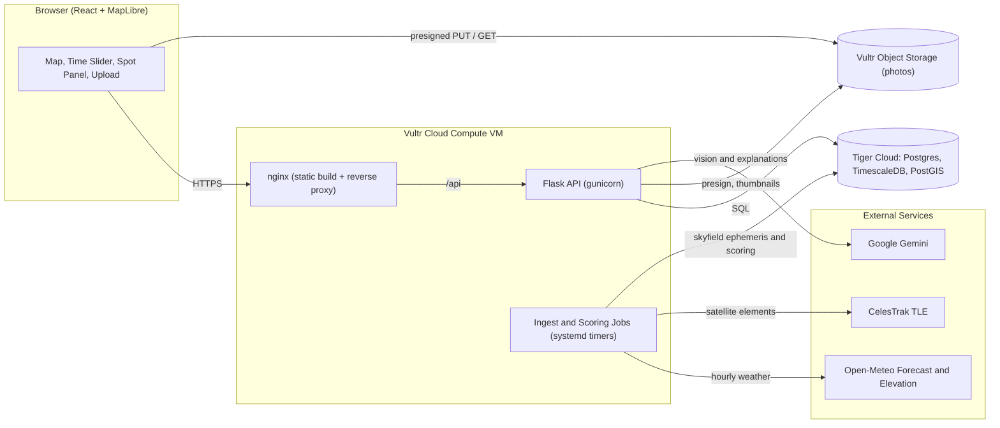
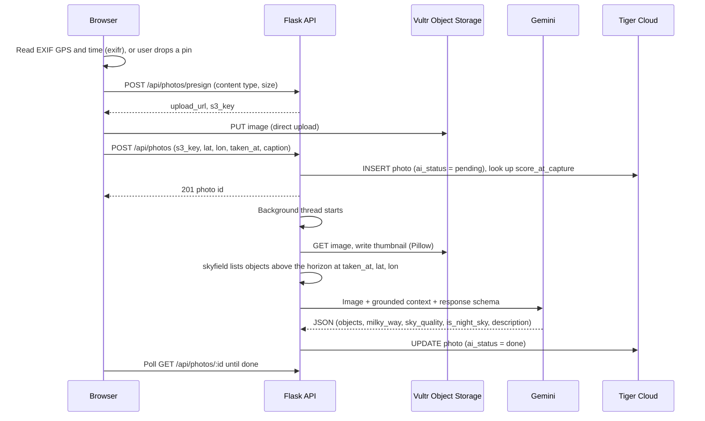

# Pleiades — System Architecture

> **Pleiades** finds the best places to stargaze in Western New York. A physics-informed AI model combines light pollution, live weather forecasts, moon and sun position, and elevation into one **Stargazing Score (0–100)** and draws it on an interactive night-sky map. Stargazers upload photos of the sky. Gemini identifies the celestial objects in each photo, and the community upvotes the best shots.

Built for **UB Hacking 2026** (theme: *Space*). Team of 3, ~24 hours.

---

## 1. Goals & Prize-Track Mapping

| Track | What it asks for | How Pleiades targets it |
|---|---|---|
| **Radial Atoms (sponsor)** | AI connected to the real world through sensors, data, or simulation; bonus for Buffalo/WNY | Live Open-Meteo weather, satellite light-pollution data, and astronomical ephemeris feed an AI scoring model. Built specifically for Western New York. Every forecast revision is logged as a sensor-style time series. |
| **Best General Hack** | Best overall project | A complete, deployed product: live map, AI score, community photos, sky events. |
| **Best UI/UX** | Clear, accessible, thoughtfully designed | Dark full-screen map, time slider, score explanations in plain English, color-blind-safe palette, keyboard navigation, red "night mode" that preserves dark-adapted vision. |
| **Best AI/ML** | Strong use of ML/LLMs/agents with real engineering | Feature-engineered, physics-informed scoring model (sky brightness → limiting magnitude → transparency), Gemini explanations, Gemini vision **grounded with real ephemeris data** to reduce hallucination, and a stretch weak-label calibration loop. |
| **Spirit of the Hackathon** | Space, astronomy, satellites | Stargazing, celestial object identification, planet visibility, ISS passes, meteor showers, moon phase. |
| **Best Use of Tiger Data** | Tiger Data (Postgres for real-time / time-series data) as the database | Hypertables for forecasts, ephemeris, and scores; hierarchical continuous aggregates; compression and retention policies; PostGIS spatial queries. The forecast time slider and score history both run on time-series queries. |

---

## 2. Tech Stack

| Layer | Choice | Notes |
|---|---|---|
| **Frontend** | React 18 + Vite + TypeScript | Single-page web app that works in desktop and mobile browsers. |
| Map | MapLibre GL JS | Open source, no API key. Dark basemap (OpenFreeMap or CARTO Dark Matter). |
| Data fetching | TanStack Query | Caching and refetching for the score grid and photos. |
| Styling | Tailwind CSS | Fast, consistent UI. |
| Charts | Recharts | Score history sparkline and forecast charts. |
| EXIF parsing | `exifr` | Reads GPS and capture time from photos in the browser. |
| **Backend** | Python 3.11+ / Flask | App factory + blueprints. Served by gunicorn (`gthread` workers). |
| DB driver | `psycopg` 3 + `psycopg_pool` | Raw SQL; no ORM needed for the hackathon. |
| Validation | Pydantic v2 | Request/response models double as the API contract. |
| **Weather** | [Open-Meteo Forecast API](https://open-meteo.com/en/docs) | Hourly `cloud_cover_low/mid/high`, `cloud_cover`, `visibility`, `relative_humidity_2m`, `dew_point_2m`, `temperature_2m`, `wind_speed_10m`, `precipitation_probability`. Multi-coordinate requests. |
| **Elevation** | Open-Meteo Elevation API | Fetched once per grid cell. |
| **Light pollution** | Falchi *World Atlas of Artificial Night Sky Brightness* (GeoTIFF), VIIRS as backup | Sampled once with `rasterio` and converted to mag/arcsec² and Bortle class. |
| **Astronomy** | `skyfield` (+ `de421.bsp`) | Sun/moon altitude, moon illumination, twilight, planet visibility, ISS passes (CelesTrak TLE). |
| **AI** | Google Gemini (Flash-class model) via `google-genai` SDK | Vision analysis of photos and score explanations. Structured JSON output via response schemas. Model name set by the `GEMINI_MODEL` env var. |
| Scoring math | NumPy | Vectorized over every cell × hour. |
| **Database** | **Tiger Data** (Tiger Cloud: PostgreSQL + TimescaleDB + PostGIS) | Hypertables, continuous aggregates, compression, retention, spatial indexes. |
| **Object storage** | **Vultr Object Storage** (S3-compatible, e.g. `ewr1.vultrobjects.com`) | `boto3` with a custom `endpoint_url`. Presigned PUT for uploads, public-read or presigned GET for display. |
| **Hosting** | **Vultr Cloud Compute** VM (Ubuntu, NJ region) | nginx serves the React build and proxies `/api` to gunicorn. systemd timers run the ingest and scoring jobs. Let's Encrypt TLS. |

---

## 3. System Architecture



**Components**

1. **Frontend (React SPA)**: renders the map, score layer, time slider, spot details, photo gallery, and upload flow. Talks only to `/api` and to Vultr through presigned URLs.
2. **Flask API**: stateless REST API. Serves scores, history, photos, and sky events. Issues presigned upload URLs. Runs Gemini photo analysis in a background thread pool.
3. **Ingest & scoring jobs**: Python CLI entry points (`python -m app.ingest weather`, `python -m app.ingest score`) triggered by systemd timers. They pull external data, compute scores, and write to Tiger.
4. **Tiger Cloud**: the single source of truth for all relational, spatial, and time-series data.
5. **Vultr Object Storage**: original photos and generated thumbnails.

---

## 4. Spatial Model

- **Region:** Western New York bounding box, about **lat 42.0 → 43.4, lon −79.8 → −77.0** (Buffalo, Niagara, Rochester, Southern Tier, Allegany).
- **Grid:** 0.1° spacing (~8–11 km), giving ~435 points and **~350 cells** after dropping points over Lake Erie and Lake Ontario. Each cell is drawn on the map as a square polygon colored by score.
- **Curated spots (~15):** well-known stargazing locations scored at their exact coordinates and pinned on the map, for example Beaver Meadow Audubon Center (observatory), Allegany State Park, Letchworth State Park, Chestnut Ridge Park, Darien Lakes State Park, and Genesee Valley sites. Stored in `grid_cells` with `is_curated = true`.

The static per-cell attributes (elevation, artificial sky brightness, Bortle class) are computed once by `data/build_grid.py` and loaded into `grid_cells`.

---

## 5. Data Pipeline

### 5.1 One-time static preprocessing (`data/`)
1. Generate grid points and remove water cells using a simple land polygon or Natural Earth lakes.
2. **Light pollution:** sample the Falchi atlas GeoTIFF at each point. The atlas gives artificial brightness in mcd/m². Add natural sky background (~0.171 mcd/m² ≈ 22.0 mag/arcsec²) and convert to surface brightness:
   `m_sky = −2.5 · log10(L_cd_m² / 108000)`. Derive the Bortle class from `m_sky`.
3. **Elevation:** one batched call to the Open-Meteo Elevation API.
4. Write the results to `grid_cells` (SQL `COPY`).

### 5.2 Recurring jobs (systemd timers on the Vultr VM)

| Job | Schedule | What it does |
|---|---|---|
| `ingest weather` | every **3 h** (matches weather-model update cadence and keeps us well inside Open-Meteo free-tier limits) | Batched multi-location requests (~50 coordinates per call) for the 72 h hourly forecast → insert into `weather_forecast` with `fetched_at = now()`. **Earlier revisions are kept**, not overwritten. |
| `ingest astro` | daily (+ on deploy) | skyfield computes sun altitude, moon altitude, illumination, and phase for every hour of the next 72 h at the region centroid → `astro_conditions`. Planet visibility, ISS passes, and meteor showers → `sky_events`. |
| `score` | **hourly** + after each weather ingest | Joins the latest forecast, astro conditions, and static cell data, runs the vectorized scoring model, and inserts into `score_snapshots` (with `computed_at`, `model_version`, factor breakdown). |

Moon and sun altitude vary by less than ~1.5° across WNY, so a single region-centroid ephemeris per hour is accurate enough for scoring. Photo grounding uses exact per-photo coordinates (§7).

Keeping every forecast revision turns the database into a **sensor log**: for any spot and night we can show how the predicted score changed as the night approached. This is the core of the Radial Atoms and Tiger Data story.

---

## 6. Stargazing Score Model (AI/ML core)

### 6.1 Features per cell × hour

| Feature | Source | Effect |
|---|---|---|
| Artificial + natural sky brightness `m_sky` (mag/arcsec²) | Light-pollution atlas | Dominant long-term factor |
| Moon illumination, moon altitude | skyfield | Moonlight brightens the sky background |
| Sun altitude | skyfield | Twilight gate |
| Cloud cover low / mid / high (%) | Open-Meteo | Low cloud blocks the most light; high cirrus the least |
| Relative humidity, dew-point spread | Open-Meteo | Haze, dew on optics |
| Visibility (m) | Open-Meteo | Aerosols and haze |
| Elevation (m) | Open-Meteo | Thinner air, above valley fog |
| Wind speed | Open-Meteo | Comfort; minor seeing proxy |

### 6.2 Model

The score estimates **how many stars a person could actually see**, not a hand-picked weighted average.

1. **Twilight gate:** `g_sun = 0` if sun altitude > −12°, rising linearly to `1` at −18° (astronomical night).
2. **Sky background:** combine the cell's dark-sky brightness with **moonlight**, using a simplified Krisciunas & Schaefer (1991) model driven by moon phase angle, moon altitude, and an extinction coefficient `k` that rises with humidity and falls with visibility. Brightnesses are added in linear units (nanoLamberts) and converted back to `m_total` in mag/arcsec².
3. **Naked-eye limiting magnitude:**
   `NELM = 7.93 − 5 · log10(10^(4.316 − m_total / 5) + 1)`
4. **Atmospheric transparency** (initial weights, tuned during the hackathon):
   `T = (1 − 0.95·low) · (1 − 0.70·mid) · (1 − 0.35·high) · haze(RH, visibility)` (cloud fractions in 0–1)
5. **Elevation bonus:** `b_elev = 1 + min(0.05, elevation_m / 10000)`
6. **Score:**
   `score = clamp(100 · g_sun · T · b_elev · clamp((NELM − 4.0) / 3.0, 0, 1), 0, 100)`

Each multiplicative term is logged in `factors` (JSONB) as **points lost** (log-decomposed), for example `{"clouds": -38, "moon": -12, "light_pollution": -9, "haze": -3, "elevation": +2}`. This breakdown drives the UI bars and the Gemini explanation. `model_version` is stored with every row so model changes stay comparable.

### 6.3 LLM explanation layer (Gemini)
`GET /api/spots/:id` sends the factor breakdown plus context (time, moon phase, visible planets) to Gemini with a short system prompt and a response schema `{summary, tips[]}`. Example output: *"Clear skies, but a 78% waxing gibbous moon washes out faint stars until it sets at 1:40 AM. Come after moonset for the Milky Way."* Results are cached in `score_explanations` per (cell, hour, model_version).

### 6.4 Stretch: closing the loop with weak labels
Every analyzed photo has a Gemini-estimated `sky_quality` (1–10) plus community upvotes, taken at a known time and place where we also have a `score_at_capture`. If time allows, fit the transparency and moon weights (least squares on `score` vs. `sky_quality`), save the result as `model_version = 2`, and show before/after agreement in the demo.

---

## 7. Photo Upload & Vision Pipeline



**Grounding:** before calling Gemini, skyfield computes which planets, the Moon, and a curated list of ~40 bright stars and constellations were **above the horizon** at that exact time and place. That list goes into the prompt as *candidates*, and Gemini is told to identify only what it can actually see. This sharply reduces hallucinated objects and is a strong engineering point for AI/ML judges.

**Vision response schema**
```json
{
  "is_night_sky": true,
  "description": "Wide-field shot of the Milky Way core rising over a treeline...",
  "objects": [{"name": "Jupiter", "type": "planet", "confidence": 0.86}],
  "milky_way_visible": true,
  "sky_quality": 7,
  "light_pollution_notes": "Orange glow on the left horizon, likely Buffalo"
}
```

**Limits & moderation:** JPEG/PNG/WebP only, ≤ 15 MB (enforced in the presign conditions). Photos with `is_night_sky = false` are hidden from the map. Uploads are rate-limited per user token.

---

## 8. Database Schema (Tiger Data)

```sql
CREATE EXTENSION IF NOT EXISTS timescaledb;
CREATE EXTENSION IF NOT EXISTS postgis;

-- Users: lightweight identity
CREATE TABLE users (
  id          uuid PRIMARY KEY DEFAULT gen_random_uuid(),
  username    text UNIQUE NOT NULL,
  token_hash  text NOT NULL,            -- sha256 of a random bearer token
  created_at  timestamptz NOT NULL DEFAULT now()
);

-- Static spatial grid + curated spots
CREATE TABLE grid_cells (
  id                   serial PRIMARY KEY,
  geom                 geography(Point, 4326) NOT NULL,
  name                 text,                 -- set for curated spots
  is_curated           boolean NOT NULL DEFAULT false,
  elevation_m          real,
  sky_brightness_mpsas real,                 -- mag/arcsec², natural + artificial
  bortle               smallint
);
CREATE INDEX ON grid_cells USING gist (geom);

-- Weather forecasts: every revision kept (sensor log)
CREATE TABLE weather_forecast (
  valid_time   timestamptz NOT NULL,
  cell_id      int NOT NULL REFERENCES grid_cells(id),
  fetched_at   timestamptz NOT NULL,
  cloud_low    real, cloud_mid real, cloud_high real, cloud_total real,
  visibility_m real, rh real, dew_point_c real, temp_c real,
  wind_kmh     real, precip_prob real,
  PRIMARY KEY (cell_id, valid_time, fetched_at)
);
SELECT create_hypertable('weather_forecast', by_range('valid_time', INTERVAL '1 day'));

-- Sun / moon ephemeris (region centroid, hourly)
CREATE TABLE astro_conditions (
  time        timestamptz PRIMARY KEY,
  sun_alt     real, moon_alt real, moon_illum real, moon_phase_deg real
);
SELECT create_hypertable('astro_conditions', by_range('time', INTERVAL '7 days'));

-- Model output: every computation kept
CREATE TABLE score_snapshots (
  valid_time    timestamptz NOT NULL,
  cell_id       int NOT NULL REFERENCES grid_cells(id),
  computed_at   timestamptz NOT NULL,
  score         real NOT NULL,
  nelm          real,
  factors       jsonb,
  model_version smallint NOT NULL,
  PRIMARY KEY (cell_id, valid_time, computed_at)
);
SELECT create_hypertable('score_snapshots', by_range('valid_time', INTERVAL '1 day'));

-- Cached Gemini explanations
CREATE TABLE score_explanations (
  cell_id int, valid_time timestamptz, model_version smallint,
  summary text, tips jsonb, created_at timestamptz DEFAULT now(),
  PRIMARY KEY (cell_id, valid_time, model_version)
);

-- Photos + votes
CREATE TABLE photos (
  id               uuid PRIMARY KEY DEFAULT gen_random_uuid(),
  user_id          uuid NOT NULL REFERENCES users(id),
  s3_key           text NOT NULL,
  thumb_key        text,
  geom             geography(Point, 4326) NOT NULL,
  cell_id          int REFERENCES grid_cells(id),
  taken_at         timestamptz,
  taken_at_source  text,                     -- 'exif' | 'user' | 'upload_time'
  uploaded_at      timestamptz NOT NULL DEFAULT now(),
  caption          text,
  score_at_capture real,
  ai_status        text NOT NULL DEFAULT 'pending',   -- pending | done | failed | rejected
  ai_description   text,
  ai_objects       jsonb,
  ai_sky_quality   smallint,
  vote_count       int NOT NULL DEFAULT 0
);
CREATE INDEX ON photos USING gist (geom);

CREATE TABLE votes (
  user_id    uuid REFERENCES users(id),
  photo_id   uuid REFERENCES photos(id) ON DELETE CASCADE,
  value      smallint NOT NULL CHECK (value IN (-1, 1)),
  created_at timestamptz NOT NULL DEFAULT now(),
  PRIMARY KEY (user_id, photo_id)
);

-- Sky events (planets, ISS passes, meteor showers, moonrise/set)
CREATE TABLE sky_events (
  time     timestamptz NOT NULL,
  type     text NOT NULL,           -- 'iss_pass' | 'planet' | 'meteor_shower' | 'moonrise' ...
  name     text NOT NULL,
  details  jsonb
);
SELECT create_hypertable('sky_events', by_range('time', INTERVAL '7 days'));
```

### Tiger Data features used

| Feature | Use |
|---|---|
| **Hypertables** | `weather_forecast`, `astro_conditions`, `score_snapshots`, `sky_events` |
| **Continuous aggregate** `cell_hourly_score` | `time_bucket('1 hour', valid_time)`, `last(score, computed_at)`: the freshest score per cell-hour. Backs the map and the time slider. |
| **Hierarchical continuous aggregate** `cell_nightly_best` | Built on `cell_hourly_score`: max score per cell per night. Backs "Tonight's best spots" and multi-night history. |
| **Real-time aggregates** | Fresh scores appear before the refresh policy runs. |
| **Compression / columnstore policy** | `weather_forecast` and `score_snapshots` chunks older than 7 days. |
| **Retention policy** | Drop raw forecast revisions after 30 days; aggregates are kept. |
| **PostGIS** | Bounding-box queries for the viewport, nearest cell for photos, "best within N km of me". |
| **Forecast-drift query** | For one cell and night, `score` by `computed_at` shows how the prediction evolved. This is a time-series view that only exists because revisions are kept. |

---

## 9. REST API

Base path `/api`. JSON everywhere. Authenticated routes need `Authorization: Bearer <token>`.

| Method | Route | Auth | Description |
|---|---|---|---|
| `POST` | `/users` | – | `{username}` → `{user_id, username, token}`. The token is stored in `localStorage`. |
| `GET` | `/scores?time=ISO&bbox=w,s,e,n` | – | GeoJSON FeatureCollection of cells with `score`, `bortle`, `top_factor`, for the slider time. |
| `GET` | `/scores/range` | – | Available forecast window (`min_time`, `max_time`) for the slider. |
| `GET` | `/best?time=ISO&near=lat,lon&radius_km=60&limit=5` | – | Top spots by score (PostGIS + aggregate). |
| `GET` | `/spots/:cell_id?time=ISO` | – | Score, NELM, factor breakdown, Gemini explanation, raw conditions. |
| `GET` | `/spots/:cell_id/history?from=&to=` | – | Hourly score series plus nightly best (from the continuous aggregates). |
| `GET` | `/spots/:cell_id/drift?night=YYYY-MM-DD` | – | Forecast revisions for one night (sensor-log view). |
| `GET` | `/sky-events?lat=&lon=&date=` | – | Moon phase/rise/set, twilight times, visible planets, ISS passes, active meteor showers. |
| `POST` | `/photos/presign` | ✔ | `{content_type, size}` → `{upload_url, s3_key}`. |
| `POST` | `/photos` | ✔ | `{s3_key, lat, lon, taken_at?, caption?}` → `{id, ai_status}`. Starts analysis. |
| `GET` | `/photos?bbox=&sort=top\|recent` | – | Photo markers (id, thumb URL, lat/lon, votes). |
| `GET` | `/photos/:id` | – | Full photo record, including AI analysis. |
| `POST` | `/photos/:id/vote` | ✔ | `{value: 1 \| -1 \| 0}` (upsert/delete). |
| `GET` | `/health` | – | DB + storage reachability, last ingest time. |

**Example `/scores` feature**
```json
{
  "type": "Feature",
  "geometry": {"type": "Polygon", "coordinates": [[[-78.85,42.85],[-78.75,42.85],[-78.75,42.95],[-78.85,42.95],[-78.85,42.85]]]},
  "properties": {"cell_id": 117, "score": 34.5, "bortle": 7, "top_factor": "light_pollution", "is_curated": false}
}
```

---

## 10. Frontend UX

**Layout**
- **Full-screen dark map** centered on WNY, with a **score layer** of grid polygons on a color-blind-safe sequential palette (cividis/viridis-like) and soft edges. Curated spots appear as star-shaped pins.
- **Time slider** (bottom): from now to +72 h in hourly steps, with tick marks at sunset and astronomical dusk and a **"Tonight's best"** snap button. Moving the slider refetches `/scores?time=` (cached by TanStack Query).
- **Spot panel** (side sheet on desktop, bottom sheet on mobile): large score gauge, NELM ("you'll see stars down to magnitude 6.1"), **factor breakdown bars** (points lost to clouds, moon, light pollution...), Gemini explanation and tips, score history sparkline, forecast-drift chart, nearby photos, and a "Get directions" link.
- **Sky tonight panel**: moon phase graphic and rise/set, twilight times, visible planets, next ISS pass, active meteor showers (in November: the Taurids and Leonids).
- **Photo layer**: clustered thumbnail markers. Clicking one opens a lightbox with the photo, AI description, identified-object chips, `score_at_capture`, and upvote/downvote.
- **Upload flow**: pick an image → EXIF auto-fills location and time (with a map pin to confirm or adjust) → upload progress → "Analyzing the sky..." state → AI results.
- **Onboarding**: one-screen username prompt the first time the user uploads or votes.

**Accessibility & polish**
- Scores are always shown as a **number and label** ("Excellent", "Good", "Fair", "Poor"), never as color alone.
- Full keyboard navigation, visible focus rings, ARIA labels on map controls, WCAG AA contrast.
- **Red night-mode toggle** (whole-app red filter) that preserves dark-adapted vision in the field.
- "Locate me" via browser geolocation (requires HTTPS, see §12).
- Skeleton loaders and helpful empty states.

---

## 11. Repository Layout

```
pleiades/
├── Architecture.md
├── README.md
├── .env.example
├── frontend/                  # Vite + React + TS
│   └── src/
│       ├── api/               # typed client + TanStack Query hooks
│       ├── components/        # Map, ScoreLayer, TimeSlider, SpotPanel, PhotoLightbox, UploadFlow, SkyPanel
│       ├── lib/               # color scales, formatters, exif helpers
│       └── App.tsx
├── backend/
│   ├── app/
│   │   ├── __init__.py        # create_app()
│   │   ├── config.py
│   │   ├── db.py              # psycopg pool
│   │   ├── api/               # blueprints: scores, spots, photos, users, sky, health
│   │   ├── schemas/           # Pydantic models (API contract)
│   │   ├── scoring/           # features.py, moonlight.py, model.py (vectorized)
│   │   ├── astro/             # skyfield helpers, sky events, visible-object lists
│   │   ├── ai/                # gemini client, vision.py, explain.py, prompt templates
│   │   ├── storage/           # Vultr S3 presign, thumbnails
│   │   └── ingest/            # __main__.py: weather | astro | score
│   ├── tests/
│   └── requirements.txt
├── data/
│   ├── build_grid.py          # grid + light pollution + elevation → grid_cells
│   └── curated_spots.json
├── db/
│   └── migrations/            # 001_init.sql, 002_aggregates.sql, ...
└── infra/
    ├── nginx.conf
    ├── pleiades-api.service
    ├── pleiades-ingest-weather.{service,timer}
    └── pleiades-score.{service,timer}
```

---

## 12. Deployment (Vultr)

- **VM:** Vultr Cloud Compute, Ubuntu LTS, 2 vCPU / 4 GB, New Jersey region (closest to Buffalo and to the `ewr1` object storage).
- **nginx:** serves `frontend/dist` and proxies `/api` → `127.0.0.1:8000` (gunicorn, `--worker-class gthread`).
- **TLS:** Let's Encrypt via certbot. Without a custom domain, use `<vm-ip>.sslip.io`. **HTTPS is required** for browser geolocation.
- **Jobs:** systemd timers for `ingest weather` (3 h) and `score` (hourly). `ingest astro` runs daily.
- **Object storage:** Vultr bucket `pleiades-photos` with a CORS rule allowing `PUT`/`GET` from the app origin. Originals and thumbnails live under `photos/{uuid}.jpg` and `thumbs/{uuid}.jpg`.
- **Database:** Tiger Cloud service with PostGIS enabled. The Vultr VM's IP is allow-listed. `sslmode=require`.
- **Deploy:** `git pull && npm run build && pip install -r requirements.txt && systemctl restart pleiades-api` (a script in `infra/deploy.sh`).

### Local development
- Backend: `flask --app app run --debug`, pointed at a shared Tiger Cloud dev service (or a local `timescale/timescaledb-ha` Docker image, which includes PostGIS).
- Frontend: `npm run dev` with Vite proxying `/api` → `localhost:5000`.

### Configuration (`.env`, never committed)
```
DATABASE_URL=postgres://...tsdb.cloud.timescale.com:5432/tsdb?sslmode=require
GEMINI_API_KEY=...
GEMINI_MODEL=gemini-...-flash
VULTR_S3_ENDPOINT=https://ewr1.vultrobjects.com
VULTR_S3_ACCESS_KEY=...
VULTR_S3_SECRET_KEY=...
VULTR_S3_BUCKET=pleiades-photos
PUBLIC_APP_ORIGIN=https://<host>
```

---

## 13. Team Plan (3 people, ~24 h)

| Role | Owner | Responsibilities |
|---|---|---|
| **A: Frontend / UX** | TBD | Map + score layer, time slider, spot panel, sky panel, photo layer + lightbox, upload flow, night mode, accessibility. |
| **B: Backend / Data** | TBD | Tiger schema + aggregates/policies, Flask API, Open-Meteo ingest, Vultr storage (presign, thumbnails), VM deploy, systemd timers. |
| **C: AI / ML / Astro** | TBD | Grid + light-pollution preprocessing, scoring model, skyfield (ephemeris, sky events, visible-object grounding), Gemini vision + explanations, stretch calibration. |

| Hours | Milestone |
|---|---|
| **0–2** | Repos scaffolded. Tiger service and Vultr VM/bucket created. `001_init.sql` applied. Pydantic API contract agreed; frontend uses mocks. |
| **2–10** | **Vertical slice:** `grid_cells` loaded → weather ingest → scoring v1 → `/scores` → colored grid on the map. |
| **10–16** | Photo upload end to end (presign → Vultr → Gemini vision → lightbox). Time slider. Spot panel with factor breakdown + Gemini explanation. |
| **16–20** | Continuous aggregates, history and drift charts, sky events panel, voting, night mode, mobile polish. |
| **20–22** | Production deploy on Vultr with HTTPS. Seed demo photos (real WNY night-sky shots). Bug bash. |
| **22–24** | Demo script, Devpost write-up, screenshots/video. Stretch calibration only if everything else is solid. |

**Integration rule:** the Pydantic schemas in `backend/app/schemas/` are the contract. Change them only with a heads-up to the whole team.

---

## 14. Risks & Fallbacks

| Risk | Mitigation |
|---|---|
| Open-Meteo rate limits | Batch locations per request, ingest every 3 h, cache. If needed, drop to a 0.15° grid. |
| Light-pollution raster unavailable or too slow to process | Fallback: estimate `m_sky` from distance-weighted population of Buffalo, Rochester, Niagara Falls, Jamestown, Olean (Walker's law). |
| Gemini latency or errors | Async background analysis with `ai_status` polling, retries, and the `failed` state shown gracefully. Explanations cached. |
| Gemini hallucinating objects | Ephemeris-grounded candidate list plus confidence scores. Low-confidence objects are hidden. |
| Cloudy weather during the demo | The slider shows upcoming clear windows, history shows past clear nights, and seeded photos show the gallery. |
| Tiger connectivity from the VM | Allow-list the VM IP early (hour 0–2), and expose a `/health` check. |
| Scope creep | Extras are strictly ordered: slider → sky events → history/drift → calibration. |

---

## 15. Demo Script (~3 min)

1. **Hook (15 s):** "Buffalo has some of the worst light pollution in the state, yet dark skies are an hour away. Where should you go tonight?"
2. **Map (40 s):** open the live app, see the WNY score map, and click a dark spot like Allegany. Show the score gauge, factor breakdown, and Gemini explanation (*Radial Atoms, AI/ML, UI/UX*).
3. **Time slider (30 s):** scrub to 2 AM, where the moon sets and scores jump. Hit "Tonight's best" (*UI/UX, Tiger Data*).
4. **Sky tonight (20 s):** visible planets, next ISS pass, Leonids coming up (*Space*).
5. **Upload (40 s):** upload a real night-sky photo. EXIF places it on the map. Gemini identifies Jupiter and the Pleiades, grounded by the ephemeris (*AI/ML, Space*).
6. **Sensor log (25 s):** history and forecast-drift chart showing how tonight's prediction evolved, plus the hypertables, continuous aggregates, and PostGIS that power it (*Tiger Data, Radial Atoms*).
7. **Close (10 s):** "Pleiades: real data, real AI, real dark skies for Western New York."
