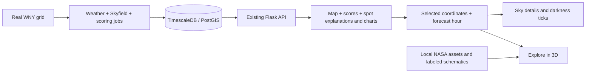

# Project integration review

Updated November 8, 2026 (America/New_York). Start with the current guidance below. The historical log preserves earlier failures and pending setup steps; those entries do not override the later successful database startup or the current explorer implementation.

## Current integration snapshot

- The full-height map, selected spot, forecast hour, sky panel and Explore in 3D share observing context. Selection priority is selected spot/cell, in-coverage GPS, then WNY center. Stale spot weather is omitted.
- The explorer has **263 models**, **73 constellations**, all **110 Messier targets**, all seven other planets and the Moon, bright stars and deep-sky targets. All objects have dedicated **2D thumbnails**. Nebula clouds and most model depth are enhanced educational illustrations; the Moon uses NASA lunar surface imagery.
- Models rotate automatically at 12 degrees/second, including reduced-motion mode, per the user's explicit choice. Pause/Resume is always available. Left/right camera buttons and Reset pause rotation; pointer dragging does not explicitly pause it.
- Default **Visibility** sorting uses the selected location/time: above horizon, unknown, below horizon. Fixed objects have approximate catalog-based altitude estimates, including during API outages. Planets/Moon use matched nightly rise/set estimates. Search/filter/sort operate on the full collection before 24-card pagination; Name (A–Z) is also available.
- An optional **Visible tonight** switch now filters objects estimated above the horizon sometime during the selected local night. It defaults off, combines with category/search, and runs before sorting/pagination. The matched night window prefers astronomical dusk/dawn, falling back to sunset/sunrise; unknown estimates are excluded. Missing night data are explained and users can turn the switch off to browse all objects. Current-hour card statuses/sorting remain distinct from whole-night inclusion. No endpoint or asset regeneration is needed for this filter; the detailed helper contracts are in the explorer guide.
- No atlas change introduced a backend endpoint/schema, changed the scoring seam, or added a Gemini dependency. Photo upload/voting and storage-to-vision UI integration remain separate work.
- For exact props, data types, stable IDs, generated-file ownership, regeneration order, scientific limits and extension steps, use [the current explorer integration guide](frontend/EXPLORE_3D_HANDOFF.md). [Frontend setup](frontend/README.md), [frontend overview](frontend-documentation.md) and [AI/ML handoff](AI_ML_HANDOFF.md) cover adjacent ownership.
- Implementation/docs are working-tree changes; no commit or deployment is claimed. Include the untracked generated assets, metadata, thumbnail set/manifests, new scripts/components/tests and relevant tracked changes when preparing the integration commit. `git diff` alone omits untracked files; inspect `git status --short --untracked-files=normal`.

## Local API/database startup: resolved follow-up

The most recent startup repair supersedes the older reboot/database-pending notes below. Docker Desktop started successfully; `docker compose up -d db` created the local TimescaleDB/PostGIS container and persistent volume. All **3 migrations** applied. A non-reset `app.ingest bootstrap` loaded **364 grid cells**, **26,208 live weather rows**, and **26,208 score snapshots**, plus astronomy data and refreshed aggregates.

After restarting Flask, `/api/scores/range`, `/api/scores`, and `/api/sky-events?lat=43&lon=-78.8&date=2026-11-07` returned **HTTP 200**. `/api/health` reported `db: true`, `storage: false`: score service working, photo storage unconfigured. This is a recorded successful check on November 8, not a guarantee that development processes are still running or forecasts are still fresh. This documentation pass did not restart services or probe live providers.

From repository root, for the existing local database configuration:

```powershell
# Start Docker Desktop first. Preserve the existing .env and database volume.
docker compose up -d db
backend/.venv/Scripts/python.exe data/diagnose_backend.py
Set-Location backend
.venv/Scripts/python.exe -m app.migrate
# Fresh database only: loads the grid before astronomy/weather/scores.
.venv/Scripts/python.exe -m app.ingest bootstrap
# For later forecast refreshes on an already populated database, use instead:
# .venv/Scripts/python.exe -m app.ingest all
.venv/Scripts/python.exe -m flask --app app --no-debug run --host 127.0.0.1 --port 5001 --no-reload
```

The ingest commands call the live weather provider. Use the README for first-time Python/dependency/.env setup; reuse the installed environment when present. Do not use `--reset-grid`, delete volumes, replace credentials, or treat bootstrap as a synthetic-data seed. `diagnose_backend.py` reports readiness/counts without printing the URI. `configure_database.py` accepts a URI with hidden local input when configuration actually needs to change.

In another terminal, from repository root:

```powershell
Set-Location frontend
# Stop an existing Vite server before npm ci on Windows.
# npm ci  # only if dependencies need installation/restoration
npm run dev
```

Vite serves the frontend on 5173 by default and forwards `/api` to `http://127.0.0.1:5001`. Precedence is `API_PROXY_TARGET`, then `PLEIADES_DEV_API_TARGET`, then that default. Restart Vite after changing an override; remove an old teammate target before using local Flask. Production nginx/Gunicorn still uses port 8000 internally. No remote database credentials belong in frontend code.

When scores fail, distinguish: proxy `ECONNREFUSED` means no reachable Flask listener; structured 503 `database_unavailable` means Flask is reachable but the configured database is unavailable; an empty/expired forecast range needs data-readiness/ingest investigation. Check scores/range and scores, not only the overall health status. A storage-only degraded status does not prevent score use.

## Current verification and integration directions

The most recent application pass completed `npm run build`, **10 unit tests**, and **17 browser tests** (7 explorer, 3 map/API integration, 2 thumbnail, 2 sorting, 3 Visible tonight). All generated assets and all 263 thumbnails passed structural/coverage validation; the grid and updated lunar/nebula renders were visually reviewed. Browser tests use API fixtures with real local assets, so their results do not establish live DB/Gemini/storage availability. Lint passed earlier, but was not rerun for the final atlas/sorting changes. The Visible tonight implementation passed the current checks; earlier documentation-only notes do not override these results.

From `frontend/`:

```powershell
npm run build
npm run test:unit
npm run test:browser:install  # if project-local Chromium is missing
npm run test:browser -- visible-tonight.spec.ts visibility-sort.spec.ts explore.spec.ts integration.spec.ts thumbnails.spec.ts
```

Run `python frontend/scripts/verify-explore-assets.py` from repository root. Asset regeneration is optional for ordinary startup; if needed, run original preparation, expansion, thumbnails, then verification in exactly the order documented in [the explorer guide](frontend/EXPLORE_3D_HANDOFF.md#ids-assets-and-extension-workflow). Original preparation alone replaces upgraded legacy model geometry with earlier schematics. Ship runtime assets/manifests/licenses together; keep caches, test output and credentials out of changes.

For integration changes, reuse `resolveObservingContext` and the existing `ExploreIn3D` props. Preserve the full-height map shell, parent-owned forecast timestamp, same-night sky cache, dialog Escape/focus handling and viewer cleanup. Keep thumbnail URLs distinct from reference-image/model URLs, preserve stable object IDs, and use `aboveHorizon`/`altitudeDeg` rather than parsing display labels for sorting. Update count assertions deliberately when changing catalog scope. Exact selected-time planetary altitude, precision fixed-object astrometry and real observability remain limitations, not completed backend features.

## Historical integration and setup log

Everything below records earlier passes. Their pending restart/teammate/database notes and smaller test counts are historical; use the current sections above for integration.

## Decisions

- User approved small integration fixes and verification.
- Connect existing location/time state to Explore in 3D where practical.
- Preserve existing API contracts, scoring model behavior, and local assets.

## Review and work log

- Started from a clean working tree at `3eca95e`.
- Reviewed architecture, frontend/backend documentation, AI/ML and 3D handoffs, app wiring, API types/hooks, settings, data pipeline and deployment entry points.
- Found committed merge-conflict markers in frontend entry/configuration/dependency files. Resolving by preserving both branches' features is the first integration task.
- Resolved markers in `frontend/src/App.tsx`, package/lock files, `vite.config.ts`, and `AI_ML_HANDOFF.md`. Retained both model-viewer and TanStack Query dependencies and the score-map components. Installed missing chart/query dependencies without major version changes.
- Kept the full-height map and existing panels inside a map shell; placed 3D exploration below it with a small header shortcut. This prevents the new section from shrinking the map or stretching its absolute overlays.
- Added `frontend/src/lib/observingContext.ts`: selected spot/cell → GPS within actual WNY coverage → region center. Map panning bounds extend beyond coverage and are not used as proof of valid observing coordinates.
- Shared the chosen forecast hour with exploration and the existing sky endpoint's `date` parameter. Darkness ticks/sky details now follow that local night. The default score request explicitly matches the slider's clamped forecast hour.
- Passed through selected-spot cloud cover/Bortle only when details match the selected coordinates/time. Old cached weather is omitted. Missing cloud/brightness information is labeled individually.
- Protected the open spot panel from Escape while a 3D dialog is active. The dialog closes first and returns focus.
- Screenshot review found the mobile legend overlapping the forecast card. Raised the mobile legend with a small CSS adjustment and added a non-overlap browser assertion. Changed the spot's NELM copy from a guaranteed star-visibility claim to an estimated sky-background limiting magnitude, and displayed the model version beside its relative index.
- Matched the Gemini regression assertion to the already implemented 10-second provider deadline minimum, checking both an 8-second and a 12-second caller budget. No production AI behavior changed.
- Reconciled documentation: latest Role B verified Gemini/DB status takes precedence over old failures; old smoke reports/log entries remain historical evidence. Added current links and removed README's obsolete claim that AI/ML seams are placeholders.

## How the pieces fit



Model v2 remains the default physics index. Opt-in calibration v3 retains its separate index anchors and training limitations. The explorer does not calculate scores and does not depend on Gemini. Photo upload/worker/vision remains a separate backend flow; the photo UI is still pending.

## Files changed in this pass

- Frontend wiring/config: `src/App.tsx`, `src/App.css`, `vite.config.ts`, package manifest/lock.
- Shared API access: `src/api/client.ts`, `src/api/hooks.ts` add optional existing sky `date` filtering; no new endpoint.
- Selection bridge: `src/lib/observingContext.ts`; exported existing `featureCenter` from `nearestCell.ts`.
- Presentation: `SkyPanel.tsx`, `SpotPanel.tsx`, `scoreColors.ts`, explorer context caption and missing-condition text.
- Verification: `tests/browser/integration.spec.ts`, adapted explorer tests/fixture, `data/tests/test_role_c.py` timeout regression.
- Documentation: this handoff, root README, AI/ML handoff, frontend documentation, 3D handoff.

## Run the combined application

From `backend/`, with its installed virtual environment and existing `.env`:

```powershell
.venv/Scripts/python.exe -m flask --app app run --port 5001
```

In a second terminal, from `frontend/`:

```powershell
npm ci
npm run dev
```

Development proxy precedence: `API_PROXY_TARGET`, then `PLEIADES_DEV_API_TARGET`, then `http://127.0.0.1:5001`. Production nginx/Gunicorn continues to use port 8000 internally. Existing grid/bootstrap instructions stay in the backend documentation; this review did not reset or migrate a database, launch ingestion, clear caches, or deploy.

Demo path: choose Tonight's best or a map cell → inspect the score/factors/explanation → change forecast hour → open Sky details → use Explore in 3D → open Saturn. Its observing context follows the selection; reference images and model labels explain the scientific limits.

## Verification

- Backend + Role C offline suite: **149 passed, 1 skipped**, using `python -m pytest -q -m 'not db' tests ../data/tests`. Skipped live DB module requires a disposable `TEST_DATABASE_URL`; not run in this pass.
- Frontend production build: passed. Lint: passed. Existing four astronomy unit tests: passed.
- Existing six explorer browser tests passed against the merged UI. Two new integration checks passed: best-spot selection, ML factors/explanation, forecast slider, selected-night sky and rendered 3D context; mobile GPS context, full-height map and legend/slider non-overlap. Final targeted integration run: **2 passed in 9.7 seconds**. The six viewer checks and two integration checks were run in separate invocations after their relevant fixes.
- Visually reviewed the loaded OpenFreeMap basemap/selected marker and spot panel at 1440×1000, integrated Saturn with actual rendered GLB and selected-time/weather details, and 390×844 map/exploration layouts. Local screenshots: `frontend/test-results/integrated-map.png`, `integrated-desktop.png`, `integrated-mobile-map.png`, `integrated-mobile.png` (ignored QA output).
- Final production build/lint and `git diff --check` passed. Tracked source/config/docs contain no remaining merge-conflict markers. Existing Windows line-ending notices do not indicate whitespace errors.
- Local API readiness probe: no listener reachable at `127.0.0.1:5001`. Browser tests use API fixtures and real local models; they do not prove live DB/Gemini/storage availability.

## Remaining integration needs and limits

- Live full-stack demo needs the API and populated DB running. Prior Role B verification of real DB ingestion/Gemini explanations is recorded in their docs; it was not repeated here.
- Exact-time star/cluster/galaxy visibility remains unimplemented. Nightly planet rise/set supports only labeled estimates, not guaranteed weather/equipment visibility.
- Photo upload/voting UI and S3 → worker → photo result integration still need end-to-end verification. Vision accuracy has not been established on a reviewed real-photo benchmark.
- Existing explanation cache can retain template or stale forecast text. No cache deletion was performed; coordinate any cache refresh with the backend owner.
- Default model v2 and opt-in v3 use different index anchors. Historical trained NELM agreement does not establish WNY-specific/weather-dependent score accuracy.
- Existing large bundle warnings, development map sprite warning, and upstream Skyfield/NumPy deprecation remain. Dependencies were kept at their current major versions.
- Actual handset GPU/touch behavior, production deployment, sponsor eligibility and final submission requirements remain outside this verification pass.

## Score-service startup follow-up

- User reported the scores-unavailable banner after integration. Confirmed no API listener, then started Flask on `127.0.0.1:5001` with the existing backend virtual environment. The Windows Store Python launcher required running outside the sandbox.
- Score range then returned HTTP 500 because the connection pool could not reach the configured database. Added `data/diagnose_backend.py`, a read-only diagnostic that reports readiness/counts without printing credentials or connection strings. It confirmed a local port-5432 target and a connection timeout; no local PostgreSQL/Docker service was found.
- User chose an existing Tiger Data/PostgreSQL database. Added `data/configure_database.py` for hidden terminal input, replacing duplicate DATABASE_URL assignments while preserving other project settings. Awaiting the user's private configuration before restarting and checking live scores.
- Added structured HTTP 503 `database_unavailable` responses for missing database configuration, pool timeout and operational connection failures. The frontend now distinguishes this from an unreachable API instead of always asking whether Flask is running.
- Follow-up verification: **153 backend/ML tests passed, 1 skipped**; frontend build and lint passed. API was restarted and `/api/scores/range` now returns the sanitized database-specific response. User reported saving the URI, but a safe file/runtime comparison confirmed the project file remains unchanged and both still target local port 5432 with no inherited override. Awaiting identification of the existing database host; no successful live score request is claimed.
- Playwright's project-local Chromium was missing after dependency installation; restored it with `node scripts/install-browser.mjs` before rerunning browser verification.
- Restored-browser verification: **3 integration browser tests passed**, including the database-specific banner. Build, lint and whitespace checks pass. Backend remains listening on port 5001; live scores remain blocked by the unreachable saved local database target. The user indicated Tiger Cloud/teammate ownership; provided the official connection-details workflow and the absolute local helper command so the URI is saved in this checkout privately.
- User clarified that the database exists only on a teammate's computer. The current local URI is therefore appropriate for that computer, not this PC. The smallest integration path is to use the teammate's Flask API through the existing Vite `API_PROXY_TARGET` override, while PostgreSQL remains local to their backend. Pending shared-network/VPN and backend-readiness confirmation plus the teammate's reachable host address; do not substitute a guessed address.

### Teammate-hosted backend for a shared-network demo

When both computers share a trusted LAN or VPN, the teammate can run Flask from `backend/` with their existing database configuration:

```powershell
# Windows teammate
.venv/Scripts/python.exe -m flask --app app --no-debug run --host 0.0.0.0 --port 5001 --no-reload
```

```bash
# macOS/Linux teammate
.venv/bin/python -m flask --app app --no-debug run --host 0.0.0.0 --port 5001 --no-reload
```

On this PC, use the teammate's real LAN/VPN address (placeholder below) and restart Vite:

```powershell
cd frontend
$env:API_PROXY_TARGET = 'http://<TEAMMATE-IP>:5001'
npm run dev
```

Check `http://<TEAMMATE-IP>:5001/api/scores/range` from this PC before expecting scores. A health response may say `degraded` solely because photo storage is unconfigured; the score endpoints are the relevant readiness check. If there is no shared network, use an agreed private tunnel/VPN or a hosted backend instead. No remote database credentials are needed for the frontend-proxy approach.

### README local setup requested

- User requested following the README on this PC rather than connecting to their teammate's backend. Local `DATABASE_URL` remains appropriate for this path.
- Confirmed Docker Desktop is not installed (`winget list`), WSL is absent, Windows 11 Home has about 31.5 GB RAM and 528.8 GB free disk, and a hypervisor is present. CPU feature flags are masked while that hypervisor is active; they do not by themselves establish whether Docker can start.
- Built-in `wsl --install --no-distribution --no-launch` did not initialize WSL. Winget found Microsoft WSL 2.7.14, verified the installer hash, then failed with `0x80073d28` requiring administrator privileges. Launched its standard Windows UAC installation flow; awaiting installer result.
- Added Windows PowerShell equivalents and explicit Docker/WSL prerequisites to README. Replaced its outdated synthetic grid seed step with the existing real-grid import and preserved existing `.env` files. Migrations, grid bootstrap and score verification remain pending until Docker can start.
- Microsoft WSL 2.7.14 installed successfully through its UAC flow; `wsl --version` confirms it. Enabled Virtual Machine Platform via DISM `/norestart`; exit code **3010** confirms Windows requires a restart. Docker Desktop 4.98.0 download passed winget's installer hash verification and installation is in progress. No automatic reboot was requested.
- Docker Desktop installation completed successfully. Next required action is a user-controlled Windows restart. After restart: start Docker Desktop, `docker compose up -d db`, run `app.migrate`, run `app.ingest bootstrap` without reset, start Flask on 5001, and verify real score-range/scored-cell responses before launching the frontend. No database has been created or seeded yet in this pass.

### Windows npm native-file lock follow-up

- User's `npm ci` failed with `EPERM: unlink` on `@rolldown/binding-win32-x64-msvc/rolldown-binding.win32-x64-msvc.node`.
- Inspected Node command lines and loaded modules. Confirmed the holder was this checkout's Vite process (PID 73684), not the separate Codex Node processes.
- Revalidated the exact frontend directory and Vite command line, stopped only the project Vite process, and reran `npm ci --no-audit --no-fund`: **succeeded, 243 packages installed**. No lockfile removal or source reset.
- Added README guidance to stop Vite before reinstalling dependencies. Build/lint/unit verification and restoring the development server follow the successful install. Windows restart for the Docker/WSL database prerequisite is still pending.
- Verification completed: frontend production build, lint and all four unit tests passed. Restarted Vite successfully at `http://127.0.0.1:5173/`; HTTP GET returned 200. The native-file lock issue is resolved. Stop Vite before a future `npm ci` to avoid locking the loaded native binding again.
- Subsequent editor screenshot reported missing `vite/client`. Verified both `node_modules/vite/client.d.ts` and the TypeScript server were actually absent after another incomplete reinstall. Stopped the Vite execution session completely and restored all 243 packages with `npm ci`. The `types: ["vite/client"]` configuration remains valid. Leave Vite stopped while completing setup so another reinstall does not encounter the loaded native binding again.
- On the next database-unavailable report, rechecked Docker/WSL: the Docker engine pipe is absent, WSL reports it cannot start its virtualization backend, and Windows Component Based Servicing explicitly reports `RebootPending = true`. The required user-controlled Windows restart has not completed. Database startup, migrations and ingest remain pending; this is an OS prerequisite blocker rather than another frontend installation problem.
