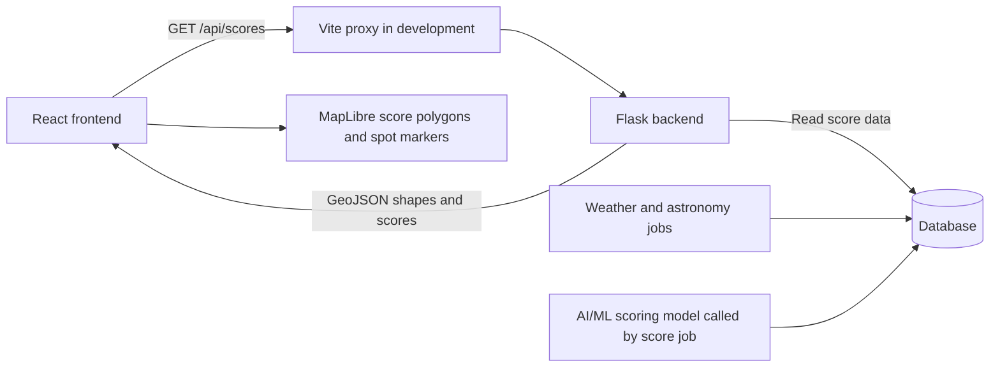

# Pleiades Frontend: Progress and Team Integration

Updated: November 7, 2026.

This document records the frontend work completed so far, explains how it fits with the backend and AI/ML work, and identifies the next steps. It describes the current code, not a completed version of every feature in the architecture.

Read alongside:

- [Architecture.md](Architecture.md): the product design and planned features.
- [backend-documentation.md](backend-documentation.md): API responses, team ownership, and backend setup.
- [README.md](README.md): the backend quickstart.

## 1. Current status

**The frontend has an interactive dark map of Western New York. It does not yet display stargazing scores or request data from Flask.**

| Item | Status |
| --- | --- |
| Vite + React 18 + TypeScript project | Set up in `frontend/` |
| ESLint | Configured in the scaffold |
| Pleiades heading and description | Added |
| Dark interactive map | Implemented with MapLibre and OpenFreeMap |
| Zoom controls, compass, distance scale | Added |
| Return-to-region button | Added |
| Western New York navigation bounds | Added |
| Responsive layout and focus indicators | Added; browser accessibility/mobile review still needed |
| Production build | Passed after map implementation and bounds change |
| Backend API connection | Not implemented yet |
| Colored score cells or sample score cells | Not implemented yet |
| Time slider, spot panel, photos, charts, voting | Planned |

We discussed using sample data to build the score layer independently. No sample cells were added. The preferred next step is to use the team's API directly once a running backend with score data is available.

## 2. Tools and what they do

These are packages inside one frontend project, rather than separate applications to open.

| Tool | Purpose | Current state |
| --- | --- | --- |
| React | Builds the page from reusable components | React and React DOM 18.3.1 installed |
| TypeScript | Checks types and catches coding mistakes before deployment | Project specifies `~6.0.3` |
| Vite | Runs the development server and creates the production build | Project specifies `^8.3.6` |
| ESLint | Checks code for common problems | Configured; lint was not run during this map work |
| MapLibre GL JS | Draws the interactive map | 6.17.0 installed |
| OpenFreeMap | Supplies the map style and geographic tiles | Used by the current map |
| TanStack Query | Will fetch/cache scores and other API responses | Not installed yet |
| Tailwind CSS | Planned styling tool in the architecture | Not installed; current styling uses ordinary CSS |
| Recharts | Will draw history and forecast charts | Not installed yet |
| `exifr` | Will read photo location and capture time | Not installed yet |

`package.json` lists dependencies and version ranges. `package-lock.json` records the resolved dependency versions so teammates can reproduce the installation with `npm ci`.

The development machine was checked earlier and had Node.js 22.20.0 and npm 10.9.3. Teammates can use that Node version to match this setup.

## 3. What we changed

### Project setup and first edit

The frontend was scaffolded with Vite's React + TypeScript template. React, React DOM, and their TypeScript definitions were aligned with React 18, as requested by the architecture.

The Vite starter page was opened successfully in the browser. The first manual edits changed its heading to **Pleiades** and its description to:

> Find your next constellation lookout in Western New York

### Main page

[frontend/src/App.tsx](frontend/src/App.tsx) now contains the header and the map component. The starter logos, counter, and documentation sections were removed from the rendered page when the map was added. The heading and description were preserved.

```tsx
import StargazingMap from './components/StargazingMap'
```

This imports the reusable map component. Inside the page, this displays it:

```tsx
<StargazingMap />
```

### Interactive map

[frontend/src/components/StargazingMap.tsx](frontend/src/components/StargazingMap.tsx) handles the map. It provides:

- A dark basemap using `https://tiles.openfreemap.org/styles/dark`.
- Dragging, scrolling, touch navigation, and MapLibre's keyboard interaction.
- Zoom buttons and a compass.
- An imperial distance scale.
- A **Back to Western New York** button that resets position, rotation, and tilt.
- A loading message and a message for map startup or resource-loading errors.
- Accessible map labeling and keyboard instructions.
- A resize observer so the map adapts when its container changes size.
- Cleanup when the component is removed, including React's development-mode mount cycle.
- Reduced-motion support for the reset animation.

MapLibre 6 uses a background worker to process map data. The component imports it using Vite's `?worker&url` syntax and passes the result to `setWorkerUrl`, so it is included in the build.

### Western New York restriction

The region matches the rectangle in the architecture:

```tsx
const WNY_BOUNDS: LngLatBoundsLike = [
  [-79.8, 42.0], // Southwest: longitude, latitude
  [-77.0, 43.4], // Northeast: longitude, latitude
]
```

The map uses both settings:

```tsx
bounds: WNY_BOUNDS,
maxBounds: WNY_BOUNDS,
```

`bounds` sets the starting view. `maxBounds` constrains navigation to the project region. This is a rectangular navigation limit, not a geographic mask that cuts out everything outside New York. The rectangle includes neighboring land and lake areas, and does not filter future API data by itself.

### Styling and browser metadata

| File | Responsibility |
| --- | --- |
| [frontend/src/App.css](frontend/src/App.css) | Header, toolbar, buttons, map sizing, status messages, focus indicators, and mobile layout |
| [frontend/src/index.css](frontend/src/index.css) | Global font, dark background, sizing, and page reset |
| [frontend/index.html](frontend/index.html) | Browser title and page description |
| [frontend/src/main.tsx](frontend/src/main.tsx) | Existing React entry point; renders `App` inside `StrictMode` |
| [frontend/package.json](frontend/package.json) | Scripts and dependencies, including MapLibre |
| [frontend/package-lock.json](frontend/package-lock.json) | Dependency versions for repeatable installation |

The browser title is **Pleiades | Western New York Stargazing**. The starter favicon remains.

## 4. What happens now versus after integration

Currently, the browser loads the frontend and requests the basemap from OpenFreeMap:

```text
Vite serves the React frontend
             ↓
React creates the MapLibre map
             ↓
MapLibre loads OpenFreeMap style, tiles, and related resources
```

This explains why the map can work while Flask is unavailable. Roads, place names, and lakes come from the basemap provider; they are not the team's stargazing data.

The planned score connection is:



In production, nginx takes over serving the frontend build and forwarding `/api` requests to Flask. The map will continue to fetch basemap resources from its map provider.

## 5. How responsibilities fit together

| Owner | Responsibility | Connection to the frontend |
| --- | --- | --- |
| A: Frontend | Code under `frontend/`; map, controls, panels, photo interactions, display states | Requests API data and presents it clearly |
| B: Backend / Data | Flask routes, database queries and migrations, ingest jobs, storage, deployment | Returns scores, details, photos, events, upload URLs, and errors |
| C: AI/ML / Astro | Scoring model, astronomical calculations, Gemini vision/explanations, grid preprocessing | Produces information that reaches the frontend through the backend |

For example, the frontend does not calculate a stargazing score. Role C supplies the model, the backend score job stores its output, Flask serves it, and the frontend chooses how to display it.

Similarly, Gemini calls belong behind the backend. The frontend will display returned explanations and photo analysis results. Database, Gemini, and storage credentials must remain in backend configuration, not frontend code or `VITE_*` variables.

The frontend implementation work described here did not change backend routes, scoring functions, database migrations, or AI functions.

### The shared contract

An API contract is the agreement about what a request contains and what its response looks like. The team's source of truth is [backend/app/schemas/](backend/app/schemas/). Section 4 of [backend-documentation.md](backend-documentation.md) explains those responses for frontend development.

Frontend TypeScript types should match these schemas. Changes to response fields or endpoint behavior need coordination with the backend owner. Changes to text, colors, and layout usually do not.

## 6. Data the frontend will use next

None of these API calls have been added to the frontend yet.

| Endpoint | Frontend use |
| --- | --- |
| `GET /api/health` | Check backend/database readiness during setup |
| `GET /api/scores/range` | Discover available forecast hours |
| `GET /api/scores?time=...&bbox=...` | Draw score polygons and curated location markers |
| `GET /api/spots/:cell_id?time=...` | Show details when a user selects a cell or spot |
| `GET /api/best` | Show the best locations for a night or hour |
| `GET /api/spots/:cell_id/history` | Draw hourly and nightly history |
| `GET /api/spots/:cell_id/drift` | Show how forecasts changed between computations |
| `GET /api/sky-events` | Display moon information, twilight, planets, and events |

Important rules from the backend guide:

- `/api/scores` returns a GeoJSON `FeatureCollection` with a `time` and `features`.
- Ordinary grid cells are `Polygon` features. Curated locations are `Point` features. They need separate map layers.
- Properties include `cell_id`, `name`, `score`, `label`, `bortle`, `top_factor`, and `is_curated`.
- Coordinates use **longitude, latitude**. The bounding-box parameter uses **west, south, east, north**.
- Scores range from 0–100. The backend sends the corresponding label: Excellent ≥75, Good ≥50, Fair ≥25, Poor <25.
- Display the number and label as well as color.
- `score` and `label` can be `null`. Display an unavailable state; do not turn missing data into a score of zero.
- Send API timestamps as ISO-8601 UTC; format times for the user separately.
- Errors use an `error` object with a `code`, `message`, and sometimes `details`.
- Spot explanations may take several seconds, so the details panel will need a loading state.

### Later photo integration

The frontend will select a photo, read available EXIF metadata, and let the user confirm location and time. It will then request an upload URL from Flask, upload the file directly to Vultr with the supplied headers, register the photo with Flask, and poll for analysis results.

Role C's vision implementation analyzes the image through the backend worker. The frontend handles `pending`, `done`, `failed`, and `rejected` display states. Uploads and votes require the bearer token issued by `POST /api/users`. These features are still pending.

## 7. How teammates run the current frontend

Get the branch containing the frontend changes. From the repository root, run:

```bash
cd frontend
npm ci
npm run dev
```

Open the local address printed by Vite, usually `http://localhost:5173`. Keep that terminal running. Press Control+C to stop it.

The current map needs an internet connection for OpenFreeMap, but it does not need the Flask backend yet.

To check a production build:

```bash
npm run build
```

To check lint rules separately:

```bash
npm run lint
```

Share source files, `package.json`, and `package-lock.json` through Git. Generated `node_modules/`, `dist/`, Python `.venv/`, and private `.env` files should not be committed. Each teammate installs dependencies locally.

## 8. Local backend setup: where we stopped

We tried opening `http://localhost:5000/api/health`, and the user reported that the browser could not connect. This establishes that the backend was not reachable at that address at that time. It does not establish that the backend code is broken.

`git pull` downloads source code. It does not start Flask, install Python dependencies, copy a teammate's private configuration, or download their database.

We then introduced the first local Python setup step:

```bash
cd backend
python3 -m venv .venv
```

At the time this document was written:

- `backend/.venv/` exists.
- Python 3.13.1 was available during the earlier environment check.
- Installation of backend dependencies and a successful Flask start have not been verified in this walkthrough.
- A repository-root `.env` file was not present. Configuration supplied through other means has not been verified.
- Docker was not available on the shell's path during the earlier check.
- No successful score API response or database-backed integration has been verified in this walkthrough.

The next backend setup work is to install its dependencies, agree with the backend owner on a local or shared development database, and run Flask. Follow the backend guide for the full setup. Coordinate database initialization and seeding with the backend owner, especially when using an existing shared database.

The frontend and backend will run in separate terminals. On one computer, the intended addresses are:

```text
Frontend: http://localhost:5173
Backend:  http://localhost:5000
```

`localhost` always means the computer making the request. If Flask runs on a teammate's computer instead, the frontend proxy needs an accessible address for that computer or a deployed backend.

The backend guide says Flask can start without a database and report `degraded` health. A reachable health endpoint alone is not proof that scores are ready. Check the response body and then verify that `/api/scores` contains usable scores for an available forecast hour.

## 9. Frontend connection still to add

[frontend/vite.config.ts](frontend/vite.config.ts) currently configures only the React plugin. **The `/api` development proxy has been discussed but has not been implemented.**

Once Flask is running locally, the planned configuration is:

```ts
import react from '@vitejs/plugin-react'
import { defineConfig } from 'vite'

export default defineConfig({
  plugins: [react()],
  server: {
    proxy: {
      '/api': 'http://localhost:5000',
    },
  },
})
```

The frontend can then request `/api/scores`, and Vite forwards the request to Flask. In production, nginx forwards that same path. The frontend API client and TanStack Query setup still need to be written.

## 10. Verification and next milestone

Completed checks during map implementation:

- The user confirmed the original Vite page opened in a browser.
- `npm run build` passed after the map was added and again after the bounds restriction.
- The production build includes the MapLibre worker asset.
- The OpenFreeMap dark style URL returned HTTP 200.
- A temporary Vite server served the updated HTML successfully and was then stopped.

Limits of those checks:

- The agent did not visually test map rendering, dragging, zooming, or mobile behavior in a browser.
- A successful build is not a visual or accessibility test.
- Vite reported a large JavaScript chunk warning; the build succeeded, but load performance has not been measured.
- Lint, backend tests, and end-to-end score integration were not run as part of this frontend map work.

The next milestone is **real API scores visible on the existing map**:

1. Start Flask with a working development database containing score data.
2. Verify `/api/health`, `/api/scores/range`, and a score response for an available hour.
3. Add Vite's `/api` proxy.
4. Add typed API fetching and TanStack Query.
5. Render polygons and curated points as separate layers, with a distinct missing-data state.
6. Make a cell clickable and display its score and label.

The time slider and full spot details panel follow once this first connection works.
