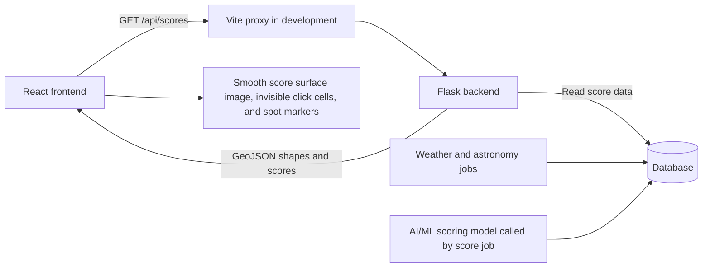

# Pleiades Frontend: Progress and Team Integration

Updated: November 7, 2026 (score map, smooth surface, overlay layout, and bounds/zoom changes).

This document records the frontend work completed so far, explains how it fits with the backend and AI/ML work, and identifies the next steps. It describes the current code, not a completed version of every feature in the architecture.

Read alongside:

- [Architecture.md](Architecture.md): the product design and planned features.
- [backend-documentation.md](backend-documentation.md): API responses, team ownership, and backend setup.
- [README.md](README.md): the backend quickstart.

## 1. Current status

**The frontend draws real stargazing scores from Flask on the dark map of Western New York as a smooth color surface, with an hour slider, a legend, click popups, and spot hover highlighting.**

| Item | Status |
| --- | --- |
| Vite + React 18 + TypeScript project | Set up in `frontend/` |
| ESLint | Configured in the scaffold |
| Pleiades heading and description | Translucent title card floating top-left over the map |
| Dark interactive map | Implemented with MapLibre and OpenFreeMap |
| Zoom controls, compass, distance scale | Added |
| Return-to-region button | Removed (it had no visible effect while panning was locked to WNY) |
| Navigation bounds and zoom | Starts fitted to the score data, 0.5 zoom level closer; panning allowed ~2° beyond the data; zoom-out limited (§3) |
| Responsive layout and focus indicators | Added; browser accessibility/mobile review still needed |
| Production build | Passed after the score layer was added |
| Backend API connection | `/api/scores` and `/api/scores/range` through the Vite proxy |
| Score surface | Smooth red → yellow → green surface blended between cells; gray for missing scores; soft fade at edges and lakes |
| Curated spot markers | Colored circles with names |
| Hour slider | Floating card over the bottom of the map; steps through the ~72 h forecast window |
| Legend, click popup, spot hover highlight | Added |
| Spot details panel, photos, charts, voting | Planned |

The score layer uses the team's API directly; no sample data is bundled. See §11 for how it works.

## 2. Tools and what they do

These are packages inside one frontend project, rather than separate applications to open.

| Tool | Purpose | Current state |
| --- | --- | --- |
| React | Builds the page from reusable components | React and React DOM 18.3.1 installed |
| TypeScript | Checks types and catches coding mistakes before deployment | Project specifies `~6.0.3` |
| Vite | Runs the development server and creates the production build | Project specifies `^8.3.6` |
| ESLint | Checks code for common problems | Configured; `npm run lint` reports one pre-existing error (§10) |
| MapLibre GL JS | Draws the interactive map | 6.17.0 installed |
| OpenFreeMap | Supplies the map style and geographic tiles | Used by the current map |
| TanStack Query | Fetches and caches API responses per hour | `@tanstack/react-query` 5 installed |
| Tailwind CSS | Planned styling tool in the architecture | Not installed; current styling uses ordinary CSS |
| Recharts | Will draw history and forecast charts | Not installed yet |
| `exifr` | Will read photo location and capture time | Not installed yet |

`package.json` lists dependencies and version ranges. `package-lock.json` records the resolved dependency versions so teammates can reproduce the installation with `npm ci`.

The development machine was checked earlier and had Node.js 22.20.0 and npm 10.9.3. Teammates can use that Node version to match this setup.

## 3. What we changed

### Project setup and first edit

The frontend was scaffolded with Vite's React + TypeScript template. React, React DOM, and their TypeScript definitions were aligned with React 18, as requested by the architecture.

The Vite starter page was opened successfully in the browser. The first manual edits changed its heading to **Pleiades** and its description to:

> Find your next constellation lookout in Western New York

### Main page

[frontend/src/App.tsx](frontend/src/App.tsx) loads the score data and renders the page. The starter logos, counter, and documentation sections were removed when the map was added. The heading and description were preserved in a floating title card.

```tsx
<header className="app-header">…Pleiades title card…</header>
<StargazingMap scores={scores.data}>
  <TimeSlider … />   {/* floating card, bottom center */}
  <ScoreLegend />    {/* bottom right */}
</StargazingMap>
```

`StargazingMap` draws everything passed as children on top of the map.

### Interactive map

[frontend/src/components/StargazingMap.tsx](frontend/src/components/StargazingMap.tsx) handles the map. It provides:

- A dark basemap using `https://tiles.openfreemap.org/styles/dark`.
- Dragging, scrolling, touch navigation, and MapLibre's keyboard interaction.
- Zoom buttons and a compass.
- An imperial distance scale.
- A loading message and a message for map startup or resource-loading errors.
- Accessible map labeling. Keyboard instructions are visually hidden but read by screen readers.
- A resize observer so the map adapts when its container changes size. It also recomputes the zoom-out limit.
- Cleanup when the component is removed, including React's development-mode mount cycle.
- The score layers: the smooth surface, invisible click targets, and curated spots (§11).

The earlier **Back to Western New York** button and the instruction strip above the map were removed.

MapLibre 6 uses a background worker to process map data. The component imports it using Vite's `?worker&url` syntax and passes the result to `setWorkerUrl`, so it is included in the build.

### Western New York view and panning limit

The starting view fits the drawn score data. That extent is the grid centres (−79.8 to −77.0, 42.0 to 43.3) plus the 0.15° fade margin the smooth surface draws around them:

```tsx
type Bounds = [[number, number], [number, number]]

const DATA_BOUNDS: Bounds = [
  [-79.95, 41.85], // Southwest: longitude, latitude
  [-76.85, 43.45], // Northeast: longitude, latitude
]
```

Panning is limited to about 2° beyond that:

```tsx
const PAN_BOUNDS: Bounds = [
  [-81.95, 39.85],
  [-74.85, 45.45],
]
const ZOOM_CLOSER = 0.5

maxBounds: PAN_BOUNDS  // panning limit
```

- **Starting view:** `cameraForBounds(DATA_BOUNDS, { padding: fitPadding() })` finds the zoom that fits the data between the title card, the slider card and the map controls. The map then opens `ZOOM_CLOSER` (0.5) levels closer, so the very edges of the colored area start just off-screen. `fitPadding()` uses different padding on desktop and on phones (≤640 px).
- **Zoom-out limit:** `minZoom` is set to the zoom at which `PAN_BOUNDS` fills the screen, plus `ZOOM_CLOSER`. It is computed by `zoomToFill()` and recalculated whenever the map resizes. You can still pan the full 2° when zoomed in.
- **Typical values:** on a 1440×900 window the map opens at zoom about 8.25 and stops zooming out at about 7.66. On a 390×844 phone it opens at about 6.9 and stops at about 6.8.
- These are rectangular navigation limits, not a mask. They don't filter API data. If the grid in `data/wny_grid.geojson` changes, update `DATA_BOUNDS` and `PAN_BOUNDS` to match.

### Styling and browser metadata

| File | Responsibility |
| --- | --- |
| [frontend/src/App.css](frontend/src/App.css) | Header, full-height map layout, overlay cards (slider, legend, popup), status messages, focus indicators, and mobile layout |
| [frontend/src/index.css](frontend/src/index.css) | Global font, dark background, sizing, and page reset |
| [frontend/index.html](frontend/index.html) | Browser title and page description |
| [frontend/src/main.tsx](frontend/src/main.tsx) | Existing React entry point; renders `App` inside `StrictMode` |
| [frontend/package.json](frontend/package.json) | Scripts and dependencies, including MapLibre |
| [frontend/package-lock.json](frontend/package-lock.json) | Dependency versions for repeatable installation |

The browser title is **Pleiades | Western New York Stargazing**. The starter favicon remains.

## 4. Data flow

The browser loads the frontend and requests the basemap from OpenFreeMap:

```text
Vite serves the React frontend
             ↓
React creates the MapLibre map
             ↓
MapLibre loads OpenFreeMap style, tiles, and related resources
```

This explains why the map can work while Flask is unavailable. Roads, place names, and lakes come from the basemap provider; they are not the team's stargazing data.

The score connection, implemented in development through the Vite proxy:



In production, nginx takes over serving the frontend build and forwarding `/api` requests to Flask. The map will continue to fetch basemap resources from its map provider.

## 5. How responsibilities fit together

| Owner | Responsibility | Connection to the frontend |
| --- | --- | --- |
| A: Frontend | Code under `frontend/`; map, controls, panels, photo interactions, display states | Requests API data and presents it clearly |
| B: Backend / Data | Flask routes, database queries and migrations, ingest jobs, storage, deployment | Returns scores, details, photos, events, upload URLs, and errors |
| C: AI/ML / Astro | Scoring model, astronomical calculations, Gemini vision/explanations, grid preprocessing | Produces information that reaches the frontend through the backend |

For example, the frontend does not calculate a stargazing score. Role C supplies the model, the backend score job stores its output, Flask serves it, and the frontend chooses how to display it.

Similarly, Gemini calls belong behind the backend. The frontend will display returned explanations and photo analysis results. Database, Gemini, and storage credentials must remain in backend configuration, not frontend code or `VITE_*` variables.

The frontend implementation work described here did not change backend routes, scoring functions, database migrations, or AI functions.

### The shared contract

An API contract is the agreement about what a request contains and what its response looks like. The team's source of truth is [backend/app/schemas/](backend/app/schemas/). Section 4 of [backend-documentation.md](backend-documentation.md) explains those responses for frontend development.

Frontend TypeScript types should match these schemas. Changes to response fields or endpoint behavior need coordination with the backend owner. Changes to text, colors, and layout usually do not.

## 6. API data used by the frontend

| Endpoint | Frontend use | Status |
| --- | --- | --- |
| `GET /api/health` | Check backend/database readiness during setup | Checked manually with `curl`; not called by the app |
| `GET /api/scores/range` | Bounds of the hour slider | **Used** |
| `GET /api/scores?time=...` | Smooth score surface and curated spot markers | **Used** (no `bbox`; the whole region is fetched) |
| `GET /api/spots/:cell_id?time=...` | Show details when a user selects a cell or spot | Planned (next milestone) |
| `GET /api/best` | Show the best locations for a night or hour | Planned |
| `GET /api/spots/:cell_id/history` | Draw hourly and nightly history | Planned |
| `GET /api/spots/:cell_id/drift` | Show how forecasts changed between computations | Planned |
| `GET /api/sky-events` | Display moon information, twilight, planets, and events | Planned |

Important rules from the backend guide:

- `/api/scores` returns a GeoJSON `FeatureCollection` with a `time` and `features`.
- Ordinary grid cells are `Polygon` features. Curated locations are `Point` features. They need separate map layers.
- Properties include `cell_id`, `name`, `score`, `label`, `bortle`, `top_factor`, and `is_curated`.
- Coordinates use **longitude, latitude**. The bounding-box parameter uses **west, south, east, north**.
- Scores range from 0–100. The backend sends the corresponding label: Excellent ≥75, Good ≥50, Fair ≥25, Poor <25.
- Display the number and label as well as color.
- `score` and `label` can be `null`. Display an unavailable state; do not turn missing data into a score of zero.
- Send API timestamps as ISO-8601 UTC; format times for the user separately.
- Errors use an `error` object with a `code`, `message`, and sometimes `details`.
- Spot explanations may take several seconds, so the details panel will need a loading state.

### Later photo integration

The frontend will select a photo, read available EXIF metadata, and let the user confirm location and time. It will then request an upload URL from Flask, upload the file directly to Vultr with the supplied headers, register the photo with Flask, and poll for analysis results.

Role C's vision implementation analyzes the image through the backend worker. The frontend handles `pending`, `done`, `failed`, and `rejected` display states. Uploads and votes require the bearer token issued by `POST /api/users`. These features are still pending.

## 7. How teammates run the current frontend

Get the branch containing the frontend changes. From the repository root, run:

```bash
cd frontend
npm ci
npm run dev
```

Open the local address printed by Vite, usually `http://localhost:5173`. Keep that terminal running. Press Control+C to stop it.

The basemap needs an internet connection for OpenFreeMap. Scores also need Flask running on `http://localhost:5001` (see §8–9). Without Flask, the map still loads, and the bottom card says scores are unavailable.

To check a production build:

```bash
npm run build
```

To check lint rules separately:

```bash
npm run lint
```

Share source files, `package.json`, and `package-lock.json` through Git. Generated `node_modules/`, `dist/`, Python `.venv/`, and private `.env` files should not be committed. Each teammate installs dependencies locally.

## 8. Local backend setup

**Current state (November 7, 2026):** Flask runs locally on **port 5001** against a database with real scores.
- `/api/health` reported `db: true` and `model_version: 2`.
- It also reported `status: "degraded"`, but only because photo storage is not configured.
- `/api/scores` returned all 364 cells and spots.

Follow [backend-documentation.md §5](backend-documentation.md) for the full setup: database, migrations, `ingest bootstrap`, and `flask run`. Coordinate database initialization and seeding with the backend owner, especially when using a shared database.

`git pull` downloads source code. It does not start Flask, install Python dependencies, copy a teammate's private configuration (`.env`), or download their database.

**Port 5001.** [backend/.flaskenv](backend/.flaskenv) sets `FLASK_RUN_PORT=5001`, because macOS AirPlay Receiver occupies port 5000. `flask run` picks this up through `python-dotenv`.
- **This file is not committed yet.** Until it is, start Flask with `--port 5001`.

The frontend and backend run in separate terminals. On one computer, the addresses are:

```text
Frontend: http://localhost:5173
Backend:  http://localhost:5001
```

`localhost` always means the computer making the request. If Flask runs on a teammate's computer instead, set `API_PROXY_TARGET` to an address that computer can be reached at, or to a deployed backend.

A reachable health endpoint alone is not proof that scores are ready. Flask can start without a database and report `degraded`. Check the response body, then verify that `/api/scores` contains usable scores for an available forecast hour.

## 9. Frontend connection

**Port note:** on macOS, port 5000 is taken by AirPlay Receiver (it answers `403`). [backend/.flaskenv](backend/.flaskenv) therefore runs Flask on **5001**, and the proxy targets `http://localhost:5001` by default. If Flask runs on another computer, point the proxy there:

```bash
API_PROXY_TARGET=http://<other-computer>:5001 npm run dev
```

The configuration in [frontend/vite.config.ts](frontend/vite.config.ts) is:

```ts
import react from '@vitejs/plugin-react'
import { defineConfig } from 'vite'

const apiTarget = process.env.API_PROXY_TARGET ?? 'http://localhost:5001'

export default defineConfig({
  plugins: [react()],
  server: {
    proxy: {
      '/api': apiTarget,
    },
  },
})
```

The frontend requests `/api/scores`, and Vite forwards the request to Flask. In production, nginx forwards that same path.

## 10. Verification and next milestone

Completed checks during map implementation:

- The user confirmed the original Vite page opened in a browser.
- `npm run build` passed after the map was added and again after the bounds restriction.
- The production build includes the MapLibre worker asset.
- The OpenFreeMap dark style URL returned HTTP 200.
- A temporary Vite server served the updated HTML successfully and was then stopped.

Limits of those checks:

- The agent did not visually test map rendering, dragging, zooming, or mobile behavior in a browser.
- A successful build is not a visual or accessibility test.
- Vite reported a large JavaScript chunk warning; the build succeeded, but load performance has not been measured.
- Lint, backend tests, and end-to-end score integration were not run as part of this frontend map work.

Checks for the score layer (November 7, 2026):

- Flask on :5001 reported `db: true`. `/api/scores/range` covered 2026-11-08T02:00Z to 2026-11-11T01:00Z.
- Through the Vite proxy, `/api/scores` returned 364 features (356 cells and 8 curated spots) with no null scores. Max score was 16 at 02:00Z, 44 at 05:00Z on Nov 8, and 69 at 05:00Z on Nov 9.
- `npm run build` passed (same large-chunk warning).
- `npm run lint`: one error, `react-hooks/set-state-in-effect` on the map's WebGL-failure `catch`. It was already in the committed map code and was left unchanged.
- The agent did not visually test the colors, slider, popups, or mobile layout in a browser.

Checks for the later layout and map changes (November 7, 2026):

- **Smooth surface.**
  - A scratchpad script ran `sampleScoreSurface()` on live `/api/scores` data.
  - At every cell centre, the drawn color was within a few RGB units of that cell's own score color.
  - The image corners, the Lake Erie and Lake Ontario gaps, and the area beyond the outer edge fade to transparent.
  - One hour builds in about 30 ms.
- **Blending method.** The first version used bilinear blending. A rendered preview showed plus-shaped artifacts around isolated bright cells, and stair-stepped lake edges. The final version uses a Gaussian-weighted blend instead.
- **Zoom values.** Computed from MapLibre's tile math for two window sizes:
  - At 1440×900 the map opens at about zoom 8.25, and the zoom-out limit is about 7.66.
  - At 390×844 it opens at about 6.9, and the limit is about 6.8.
- **Build and lint.** `npm run build` passed after each change. `npm run lint` still reports only the pre-existing `set-state-in-effect` error.
- **Not tested.** The agent did not visually test the title card, slider card, legend placement, surface, or zoom limits in a browser.

The next milestone is a **spot details panel** using `GET /api/spots/:cell_id?time=...`, with factor bars and the explanation, which needs a loading skeleton.

## 11. How the score layer works

| File | Responsibility |
| --- | --- |
| [frontend/src/api/types.ts](frontend/src/api/types.ts) | TypeScript mirror of [backend/app/schemas/scores.py](backend/app/schemas/scores.py) and the error shape |
| [frontend/src/api/client.ts](frontend/src/api/client.ts) | `fetchScores(time)`, `fetchScoreRange()`; turns `{error:{code,message}}` bodies into a thrown `ApiError` |
| [frontend/src/api/hooks.ts](frontend/src/api/hooks.ts) | TanStack Query hooks; the previous hour stays visible while the next loads |
| [frontend/src/lib/scoreColors.ts](frontend/src/lib/scoreColors.ts) | Gradient stops, the MapLibre color expression, `scoreToRgb()` for canvas drawing, the legend CSS gradient, factor names |
| [frontend/src/lib/scoreSurface.ts](frontend/src/lib/scoreSurface.ts) | Turns the grid cells into a smooth image (`sampleScoreSurface`, `buildScoreSurface`) |
| [frontend/src/lib/time.ts](frontend/src/lib/time.ts) | Eastern-time hour labels and ISO UTC request strings |
| [frontend/src/components/TimeSlider.tsx](frontend/src/components/TimeSlider.tsx) | Hourly slider over `/api/scores/range` |
| [frontend/src/components/ScoreLegend.tsx](frontend/src/components/ScoreLegend.tsx) | Color key over the map |
| [frontend/src/components/StargazingMap.tsx](frontend/src/components/StargazingMap.tsx) | Bounds and zoom, score sources and layers, spot hover, and popups |

**Colors.** Scores are blended continuously: 0 = red `#d7301f`, 50 = yellow `#f5d000`, 100 = green `#1a9850`. A `null` score is gray `#6b7280`. It is never drawn as zero. To change the palette, edit `SCORE_STOPS` in `scoreColors.ts`. The surface, spot circles and legend all read it.

**Smooth surface.** Grid cells are not drawn as squares. For each hour, `buildScoreSurface()` turns the cell polygons into one image (about 620 × 320 px, built in roughly 30 ms):

- Each pixel is a Gaussian-weighted average of the scores of nearby cell centres (σ = 0.55 cell).
- Missing cells, off the grid or over Lake Erie and Lake Ontario, get no weight, so the color fades out within about one cell instead of ending in hard, stair-stepped edges.
- Null scores pull the color toward gray. They are never treated as zero.
- Image rows are spaced in Web Mercator so the image lines up with the map.

The image goes into a MapLibre `image` source drawn by the `score-surface` raster layer at 55% opacity, under the basemap's place names. The blending means a single cell's color on the map is partly influenced by its neighbors. The popup always shows the cell's exact score.

**Layers.** One GeoJSON source (`promoteId: cell_id`) feeds three layers:

- `score-fill` draws the grid polygons fully transparent. It exists only so clicks can find the cell.
- `spot-circle` and `spot-label` draw the curated `Point`s on top of everything.

**Interaction.** Hovering over the surface shows a pointer cursor; no box is drawn, so the surface stays seamless. Hovering a curated spot enlarges its circle. Clicking opens a popup with the name (or `Grid cell #id`), score and label, Bortle class, and biggest factor. The popup is built from DOM nodes, not HTML strings.

**Time.** App startup reads `/api/scores/range` and puts the slider on the current hour. Moving the slider requests `/api/scores?time=<ISO UTC hour>` after a 150 ms pause. Each hour is cached for 5 minutes. Labels are shown in `America/New_York`.

**Layout.** The map fills the whole window. The "Pleiades" heading and subtitle sit in a translucent, blurred card floating over the top-left corner (`.app-header`). Map loading and error notices appear at the top center; on phones they appear below the title card. The hour slider is a floating card over the bottom center of the map (`.map-overlay-card`). The legend sits bottom-right. Below 1100 px wide, it moves up above the slider card. On phones (≤640 px), the card spans the width and the scale bar is hidden so it doesn't overlap. The map instructions are visually hidden but still read by screen readers through the canvas's `aria-describedby`.

**Without the backend.** The basemap still loads. The bottom card shows “Scores unavailable. Is the backend running?”

